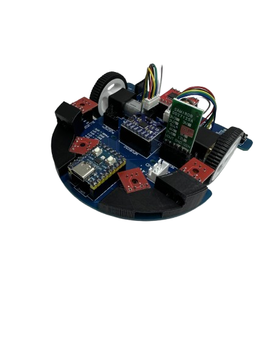

  

<h1 align="center">Micromouse RP2040 Zero</h1>

Códigos de prueba y de control para el robot tipo **Micromouse** de Banary Source, basado en el microcontrolador **RP2040 Zero**. Puedes probar cada periférico por separado y, con todo funcionando, pasar a seguir paredes con PID y enviar telemetría por WiFi o Bluetooth.

  

---

## 🚀 Empieza aquí

1. **Arma el robot** siguiendo la [guía de armado](docs/Armado.md).
2. **Configura Arduino IDE** con la [guía para RP2040](docs/Arduino_RP2040_Configuration.md).
3. **Carga el diagnóstico** [`examples/00_Diagnostico`](examples/00_Diagnostico/00_Diagnostico.ino). Abre el monitor serial a **115200** y prueba cada periférico con una letra.
4. **Sigue los ejemplos en orden**, del 01 al 14. Cada uno agrega una sola cosa nueva.

---

## 🧩 El robot

| Componente | Descripción |
|---|---|
| 🟢 RP2040 Zero | Microcontrolador principal |
| 🔵 LED RGB (Neopixel) | LED direccionable en GP16 |
| 🔘 Botón de inicio | En GP8 (presionado = `LOW`) |
| ⚙️ Motores DC | 2 motorreductores con puente H (PWM + dirección) |
| 🔄 Encoders | Uno por motor, canal A con interrupción y canal B para el sentido |
| 👀 Sensores IR | 4 sensores analógicos en GP26 a GP29 |
| 🧭 MPU6050 | Acelerómetro y giroscopio por I2C |
| 📶 Módulo inalámbrico | Bluetooth HC-06 o WiFi DT-06 en el UART0 |

## 📌 Pinout

| Función | Pin | Notas |
|---|---|---|
| Motor A, **rueda izquierda**: PWMA, AIN1, AIN2 | GP5, GP4, GP3 | |
| Motor B, **rueda derecha**: PWMB, BIN1, BIN2 | GP0, GP1, GP2 | |
| Encoder M1, **rueda izquierda**: A, B | GP15, GP14 | Interrupción en A |
| Encoder M2, **rueda derecha**: A, B | GP6, GP7 | Interrupción en A |
| Botón de inicio | GP8 | `INPUT_PULLUP`, presionado = `LOW` |
| LED RGB Neopixel | GP16 | |
| Sensores IR (ADC) | GP26, GP27, GP28, GP29 | Lecturas de 0 a 1023 |
| MPU6050 en `Wire1`: SDA, SCL | GP10, GP11 | Dirección `0x68` |
| Módulo inalámbrico en `Serial1`: TX, RX | GP12, GP13 | 9600 baud |
| Conector STARTUP | GP9 | Libre |

> ✅ **Sentido de giro verificado:** velocidad positiva = la rueda avanza y su encoder cuenta hacia arriba. `motors(+v, +v)` hace avanzar el robot en línea recta.

---

## 🧪 Ejemplos

### Diagnóstico
| Ejemplo | Qué hace |
|---|---|
| [`00_Diagnostico`](examples/00_Diagnostico/00_Diagnostico.ino) | Menú por el monitor serial para probar todo el robot: LED, botón, sensores (detecta los que no están conectados), encoders, MPU6050, motores y módulo WiFi |

### Periféricos, uno por uno
| Ejemplo | Qué hace |
|---|---|
| [`01_RGB`](examples/01_RGB/01_RGB.ino) | Cambia el LED RGB entre rojo, verde y azul |
| [`02_PushButton`](examples/02_PushButton/02_PushButton.ino) | El LED se pone rojo mientras presionas el botón |
| [`03_Motors`](examples/03_Motors/03_Motors.ino) | Los motores avanzan mientras presionas el botón (**levanta las ruedas**) |
| [`04_Sensors`](examples/04_Sensors/04_Sensors.ino) | Muestra la lectura de los 4 sensores IR |
| [`05_Encoders`](examples/05_Encoders/05_Encoders.ino) | Cuenta los pulsos de cada encoder; gira las ruedas a mano |
| [`06_MPU`](examples/06_MPU/06_MPU.ino) | Lee el MPU6050 con la librería MPU6050_light |
| [`08_MPU6050`](examples/08_MPU6050/08_MPU6050.ino) | Lee el MPU6050 con la librería de Adafruit (m/s², rad/s, °C) |
| [`12_ScanI2C`](examples/12_ScanI2C/12_ScanI2C.ino) | Busca dispositivos en el bus I2C; úsalo si el MPU6050 no responde |
| [`13_I2CDevMPU6050`](examples/13_I2CDevMPU6050/13_I2CDevMPU6050.ino) | Lee el MPU6050 con la librería I2Cdev de Jeff Rowberg, incluida en la carpeta del ejemplo |

### Sensores y control
| Ejemplo | Qué hace |
|---|---|
| [`11_SensorsFilter`](examples/11_SensorsFilter/11_SensorsFilter.ino) | Lectura de los sensores IR limitada y convertida a distancia aproximada |
| [`10_PID`](examples/10_PID/10_PID.ino) | Sigue una pared con PID (mano derecha o izquierda); los giros se hacen por tiempo |
| [`14_PIDEncoders`](examples/14_PIDEncoders/14_PIDEncoders.ino) | El mismo seguidor de pared, pero mide los giros con los encoders |

En `10_PID` y `14_PIDEncoders`, **mantén el botón al encender** para usar la mano derecha (LED azul). Si no lo presionas, usa la mano izquierda (LED rojo). Después presiona el botón para arrancar.

### Comunicación inalámbrica
| Ejemplo | Qué hace |
|---|---|
| [`07_Bluetooth`](examples/07_Bluetooth/07_Bluetooth.ino) | Cambia el color del LED con comandos enviados desde el celular o la PC |
| [`09_BluetoothPython`](examples/09_BluetoothPython/09_BluetoothPython.ino) | Envía encoders y MPU6050 en CSV; [`bluetooth_test_console.py`](examples/09_BluetoothPython/bluetooth_test_console.py) los muestra en la PC |

---

## 📶 Módulo inalámbrico

Los dos módulos usan el mismo conector `BLUETOOTH` (GP12/GP13) y funcionan como un **cable serie invisible**: lo que el robot escribe en `Serial1` sale por el aire y lo que llega por el aire se lee en `Serial1`. Los ejemplos usan el UART0 por hardware a **9600 baud**.

**Bluetooth HC-06**
- Empareja el módulo con la PC o el celular. En Windows aparece como un puerto COM.
- Consola de telemetría: `python bluetooth_test_console.py --port COM5` (usa tu puerto).

**WiFi DT-06 (ESP8266)**
- Crea su propia red abierta, `Doit_WiFi_XXXXXX`. Conecta la PC a esa red.
- Los datos van por **TCP a `192.168.4.1`, puerto `9000`**.
- Consola de telemetría: `python bluetooth_test_console.py --tcp 192.168.4.1:9000`.
- Para cambiar el baud o el modo de red, abre `http://192.168.4.1` en el navegador.
- No responde a comandos `AT`. Es normal: trae un firmware de puente transparente.

**Comandos del ejemplo `07_Bluetooth`**

| Comando | Acción | Color del LED |
|---|---|---|
| `F` | Adelante | Verde |
| `B` | Atrás | Rojo |
| `R` | Derecha | Azul |
| `L` | Izquierda | Amarillo |
| `S` | Stop | Blanco |

---

## ⚙️ Requisitos

- **Arduino IDE 2.x** con el core **Raspberry Pi Pico/RP2040** de Earle Philhower (probado con la versión 6.1.1). Ver la [guía de configuración](docs/Arduino_RP2040_Configuration.md).
- **Librerías** (instálalas desde el *Gestor de librerías*; entre paréntesis, la versión probada):
  - Adafruit NeoPixel (1.15.5): ejemplos 00, 01, 02, 07, 10 y 14
  - MPU6050_light (1.2.1): ejemplos 06 y 09
  - Adafruit MPU6050 (2.2.9), con sus dependencias Adafruit Unified Sensor y Adafruit BusIO: ejemplo 08
- Cable **USB-C** y batería de 7.4 V para los motores.
- Para la consola en Python: **Python 3** y `pip install pyserial`.

## 🛠️ Solución de problemas

| Síntoma | Qué revisar |
|---|---|
| No aparece el puerto COM | Mantén **BOOTSEL** al conectar el USB y carga el sketch otra vez. |
| El monitor serial no muestra nada | Ponlo a **115200**. Varios ejemplos esperan a que abras el monitor antes de empezar. |
| "Falló la comunicación con el MPU6050" | Carga `12_ScanI2C`: debe aparecer `0x68`. Si no aparece, revisa el módulo y su conector. |
| Los sensores dan valores al azar | Puede que no estén conectados. La prueba `s` de `00_Diagnostico` te dice cuáles están al aire. |
| Una rueda gira al revés | Revisa el conector del motor y prueba con `00_Diagnostico`, opción `m`. |
| Los motores van más lentos que ayer | Carga la batería. Con batería baja, el mismo PWM da menos velocidad y el PID se comporta distinto. |
| El DT-06 no responde a `AT` | Es normal. Conéctate a su red y usa TCP en el puerto 9000. |

---

## 🤝 Contribución
Si tienes un robot basado en este diseño y quieres mejorar las pruebas o agregar funciones, ¡las pull requests son bienvenidas!

## 🔖 Licencia
Este proyecto está bajo licencia MIT. Puedes usarlo, modificarlo y distribuirlo libremente. La librería I2Cdev/MPU6050 incluida en `examples/13_I2CDevMPU6050` es de Jeff Rowberg y también tiene licencia MIT.

---

## **📌 Autor:**
🎓 **Eric G. Vallejo**
💼 *Docente e integrador de proyectos en:*
🔹 Robótica
🔹 Automatización industrial
🔹 Sistemas embebidos y programación
