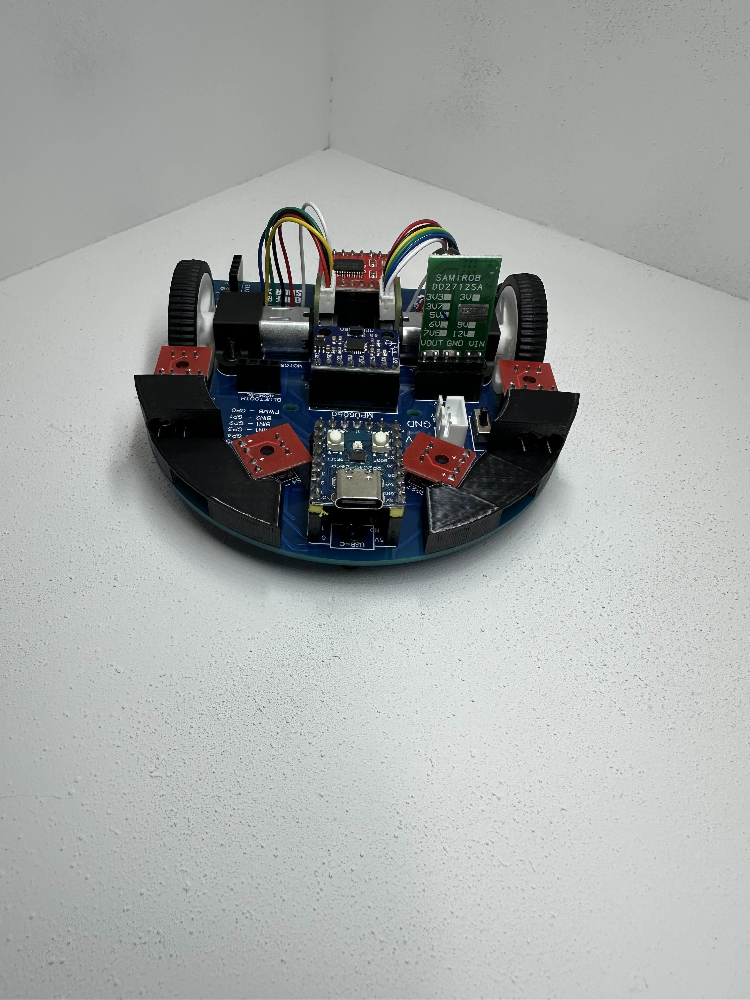
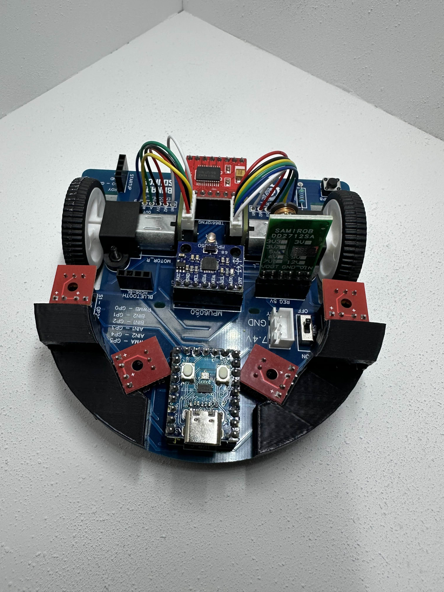
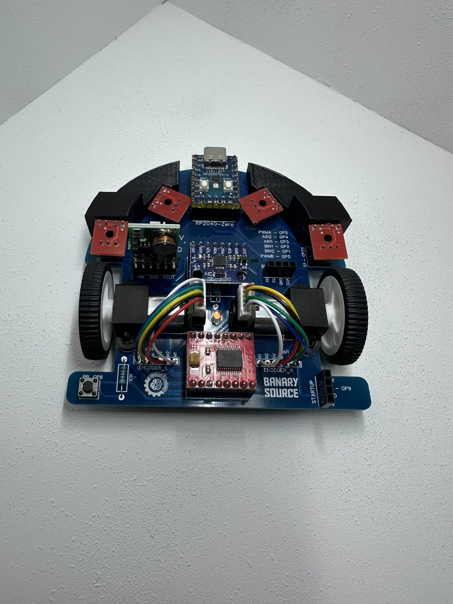
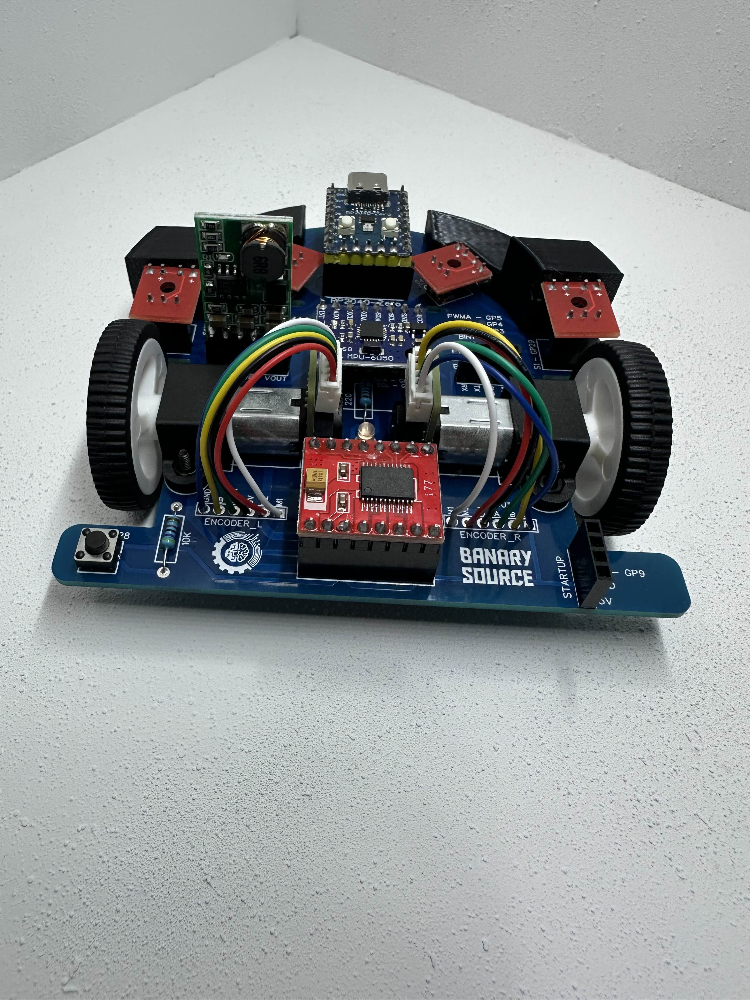
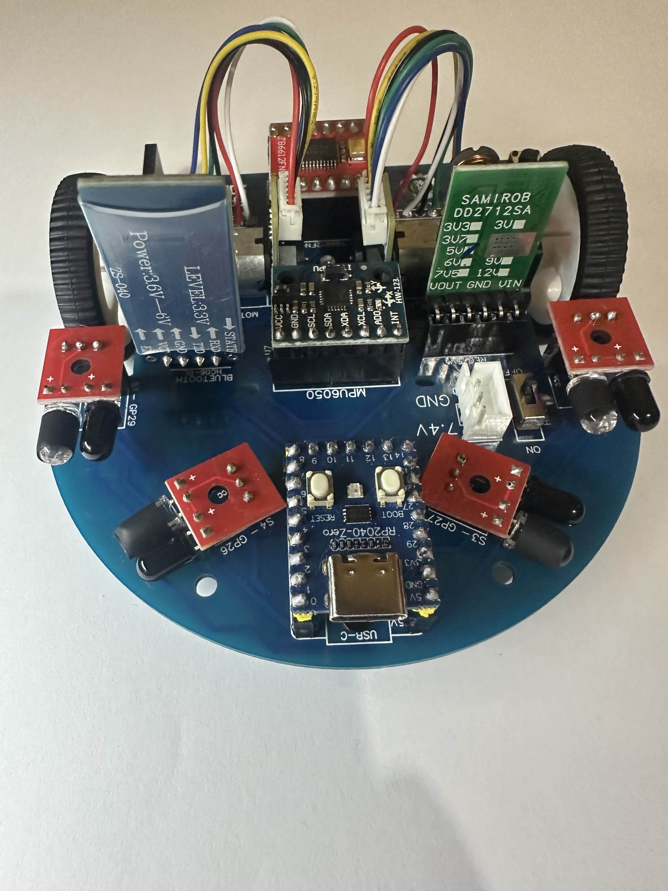
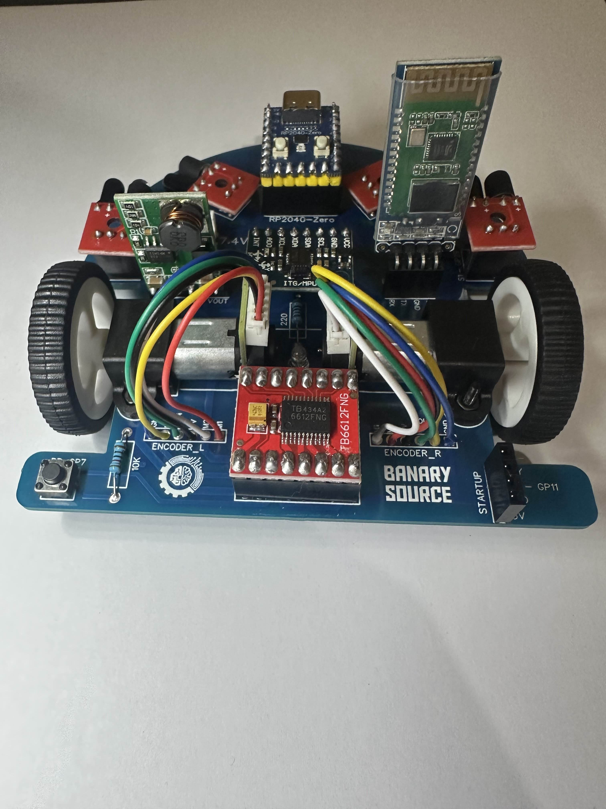

# Armado del Micromouse RP2040 Zero

Esta guía muestra cómo queda el robot armado y qué va en cada lugar de la placa. Úsala junto con la tabla de pines del [README](../README.md#-pinout).

## Qué lleva el robot

Todo se monta sobre la placa PCB de Banary Source. Las serigrafías de la placa indican dónde va cada módulo:

- **RP2040 Zero** al frente, con el conector USB-C hacia adelante.
- **MPU6050** (acelerómetro y giroscopio) al centro, en el conector marcado `MPU6050`.
- **Puente H** (módulo rojo) en la parte trasera, entre los dos motores.
- **Regulador de 5 V** (módulo verde, serigrafía `REG 5V`).
- **2 motorreductores con encoder**. Sus cables van a los conectores `ENCODER_L` (rueda izquierda) y `ENCODER_R` (rueda derecha).
- **4 sensores IR** (placas rojas) montados en el soporte impreso en 3D.
- **Botón de inicio** en GP8, con su resistencia de 10 kΩ.
- **Conector de batería** de 7.4 V con interruptor `ON`.
- **Conector `BLUETOOTH`** para el módulo inalámbrico (HC-06 o DT-06) en GP12/GP13.
- **Conector `STARTUP`** en GP9, libre para un módulo de arranque.

## Soporte de sensores

El soporte negro que sostiene los cuatro sensores IR se imprime en 3D:

- Archivo: [`hardware/SoporteSensores.stl`](../hardware/SoporteSensores.stl)

GitHub muestra el STL en 3D si abres el enlace.

## Fotos

| Vista frontal | Vista superior |
|---|---|
|  |  |

| Vista trasera | Detalle del puente H y encoders |
|---|---|
|  |  |

| Lateral | Perspectiva |
|---|---|
|  |  |

## Después de armar

1. Configura el entorno: [Configuración Arduino para RP2040](Arduino_RP2040_Configuration.md).
2. Carga [`examples/00_Diagnostico`](../examples/00_Diagnostico/00_Diagnostico.ino) y prueba cada periférico desde el monitor serial.
3. Levanta las ruedas del suelo antes de probar los motores.
